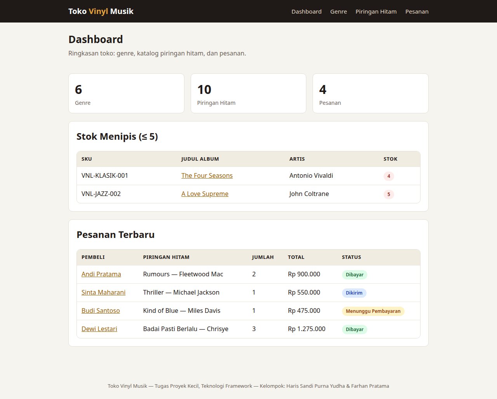
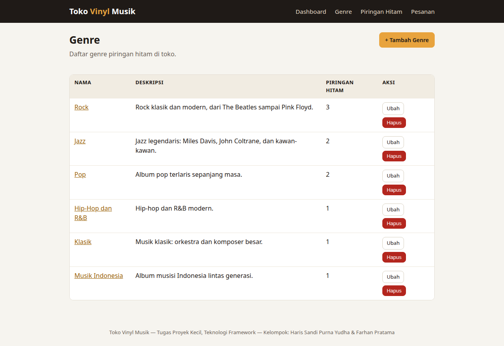
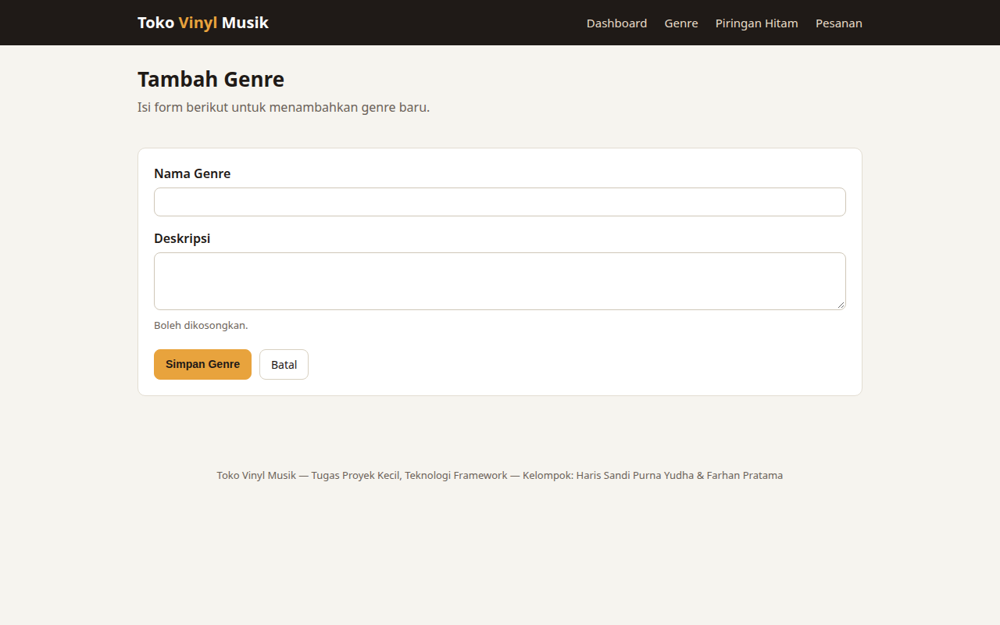
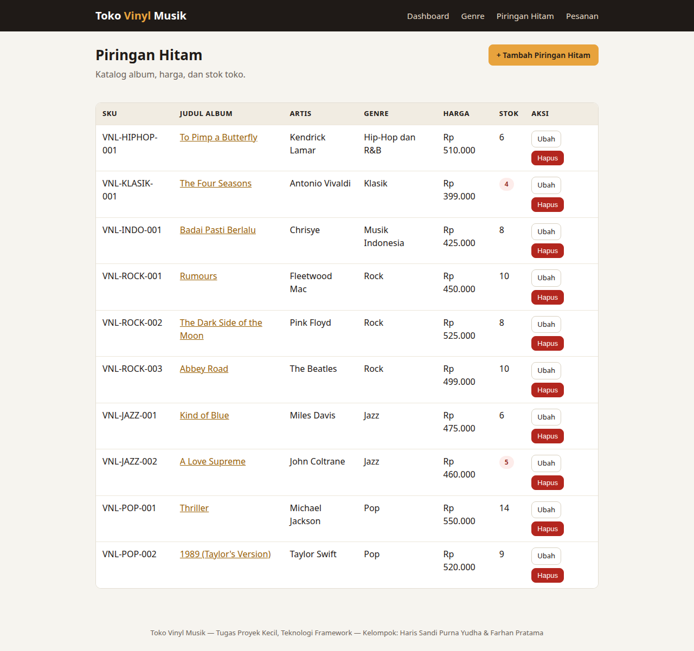
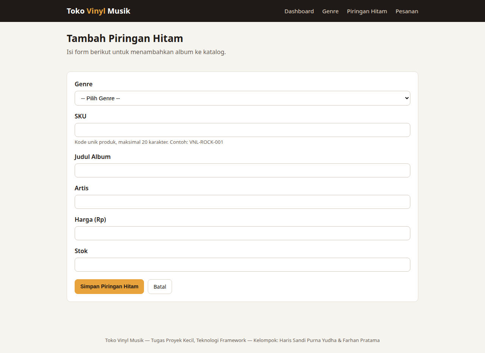
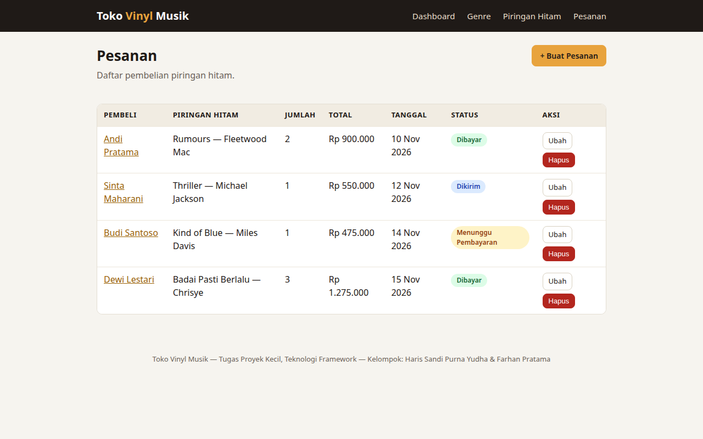
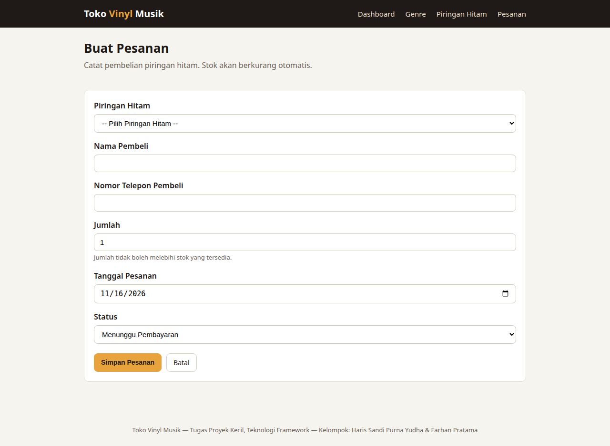
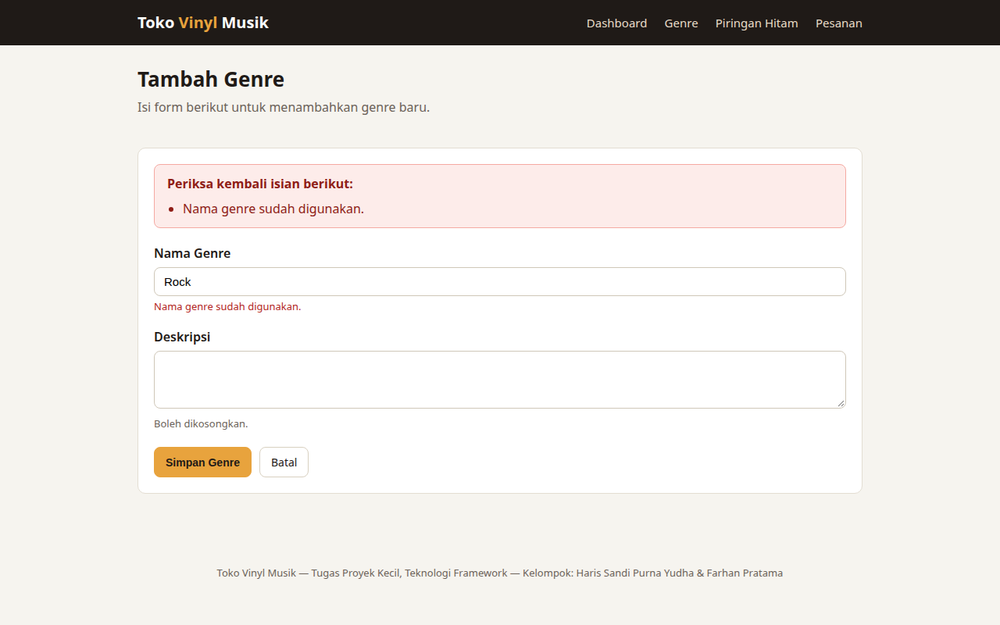
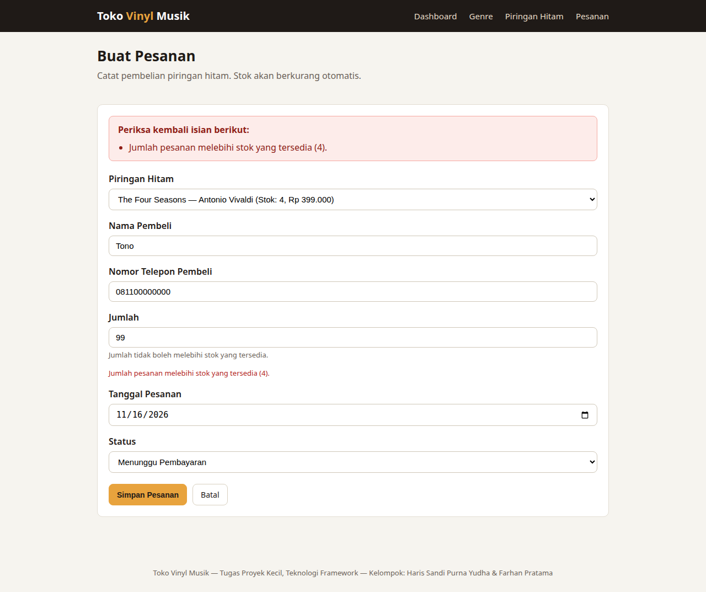
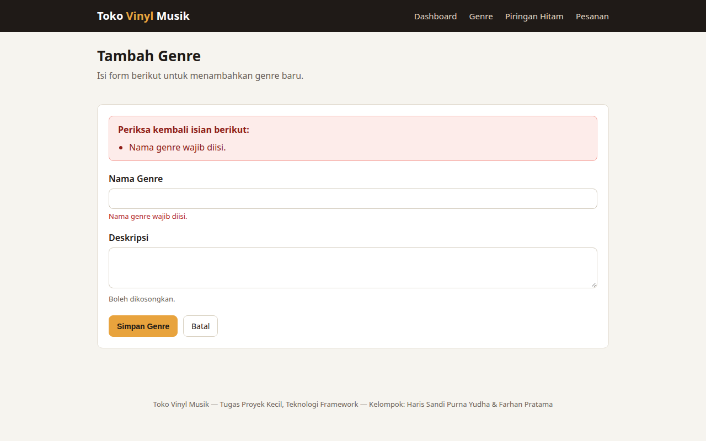

# Toko Vinyl Musik — Aplikasi CRUD dengan Eloquent ORM (Laravel)

Aplikasi web sederhana untuk mengelola penjualan piringan hitam (vinyl): katalog album,
stok, sampai pesanan pembeli. Dibangun dengan Laravel sebagai **Tugas Proyek Kecil**
mata kuliah Teknologi Framework (Materi 07: Pengelolaan Data dengan Eloquent ORM).

**Kelompok:** Haris Sandi Purna Yudha (235610001) & Farhan Pratama (245610053)

## Fitur

Tiga modul, masing-masing dengan CRUD lengkap (Create, Read, Update, Delete):

| Modul | Mengelola | Relasi |
| --- | --- | --- |
| Genre (`categories`) | Nama genre (unik), deskripsi | Satu genre memiliki banyak piringan hitam |
| Piringan Hitam (`products`) | SKU (unik), judul album, artis, harga, stok, genre | Satu album dapat muncul di banyak pesanan |
| Pesanan (`orders`) | Pembeli, piringan hitam, jumlah, total harga, tanggal, status | Setiap pesanan memuat satu piringan hitam |

Selain itu:

- **Dashboard** — ringkasan jumlah genre/produk/pesanan, daftar stok menipis, dan
  5 pesanan terbaru.
- **Validasi Form Request** — nama genre dan SKU unik, harga dan stok tidak boleh
  negatif, jumlah pesanan minimal 1, field wajib diisi; pesan error berbahasa
  Indonesia dan input lama dipertahankan (`old()`).
- **Pesan keberhasilan & kesalahan** — flash message setelah simpan/ubah/hapus,
  termasuk pesan error saat hapus ditolak aturan bisnis.

## Aturan Bisnis

1. Nama genre dan SKU piringan hitam tidak boleh sama dengan data lain (unik).
2. Harga dan stok tidak boleh negatif; jumlah pesanan minimal 1.
3. Jumlah pesanan tidak boleh melebihi stok. **Stok berkurang saat pesanan dibuat**
   dan **bertambah kembali saat pesanan dihapus** (juga disesuaikan saat pesanan diubah).
4. Genre yang masih memiliki piringan hitam, dan piringan hitam yang sudah memiliki
   pesanan, **tidak dapat dihapus** (foreign key `restrict` + pengecekan di controller).
5. `unit_price` di pesanan menyimpan harga saat pesanan dibuat, sehingga perubahan
   harga di kemudian hari tidak mengubah riwayat pesanan.

## Struktur Database (ERD)

```
categories (genre) 1 ───< products (piringan hitam) 1 ───< orders (pesanan)
```

- **categories**: `id`, `name` (string, unik), `description` (text, boleh kosong)
- **products**: `id`, `category_id` (FK → categories, restrict), `sku` (string 20, unik),
  `title` (string 100), `artist` (string 100), `price` (decimal 12,2),
  `stock` (unsigned int, default 0)
- **orders**: `id`, `product_id` (FK → products, restrict), `buyer_name` (string 100),
  `buyer_phone` (string 20), `quantity` (unsigned int), `unit_price` (decimal 12,2),
  `total_price` (decimal 12,2), `order_date` (date),
  `status` (enum: pending/paid/shipped, default pending)
- Semua tabel memiliki `created_at` dan `updated_at`.

## Struktur Kode

```
app/
├── Http/
│   ├── Controllers/
│   │   ├── CategoryController.php   # Resource controller genre
│   │   ├── ProductController.php    # Resource controller piringan hitam
│   │   └── OrderController.php      # Resource controller pesanan (+ logika stok)
│   └── Requests/
│       ├── CategoryRequest.php      # Validasi genre
│       ├── ProductRequest.php       # Validasi piringan hitam
│       └── OrderRequest.php         # Validasi pesanan
├── Models/
│   ├── Category.php                 # hasMany products
│   ├── Product.php                  # belongsTo category, hasMany orders
│   └── Order.php                    # belongsTo product
database/
├── migrations/                      # 3 migrasi (categories, products, orders)
└── seeders/                         # CategorySeeder, ProductSeeder, OrderSeeder
resources/views/
├── layouts/app.blade.php            # Layout + navigasi + flash message
├── dashboard.blade.php
├── categories/  products/  orders/  # index, create, edit, show + _form
routes/web.php                        # Dashboard + Route::resource x3
tests/Feature/VinylStoreTest.php      # 6 feature test
docs/screenshots/                    # Screenshot CRUD & validasi
```

Alur MVC: `Route → Controller → (Form Request: validasi) → Model (Eloquent) →
Database → Controller → View (Blade) → Browser`.

## Cara Menjalankan

Kebutuhan: PHP 8.2+ (dengan ekstensi mbstring, sqlite, xml, curl, zip, bcmath,
intl), Composer, dan SQLite (default, tanpa instalasi database server).

```bash
# 1. Clone repo
git clone <url-repo> toko-vinyl-musik
cd toko-vinyl-musik

# 2. Instal dependensi
composer install

# 3. Siapkan environment
cp .env.example .env
php artisan key:generate

# 4. Buat database + isi data contoh
php artisan migrate --seed

# 5. Jalankan server
php artisan serve
# Buka http://localhost:8000
```

Data contoh dari seeder: 6 genre (Rock, Jazz, Pop, Hip-Hop dan R&B, Klasik,
Musik Indonesia), 10 piringan hitam, dan 4 pesanan.

## Pengujian

```bash
php artisan test
```

6 feature test (50 assertions) — mencakup CRUD genre & produk, validasi unik dan
harga negatif, pesanan mengurangi stok, pesanan melebihi stok ditolak, hapus
pesanan mengembalikan stok, dan update pesanan menyesuaikan stok.

## Screenshot

### Dashboard



### Daftar & Form Genre




### Daftar & Form Piringan Hitam




### Daftar & Form Pesanan




### Pengujian Validasi





## Referensi

- Laravel, "Eloquent: Getting Started", https://laravel.com/docs/eloquent
- Laravel, "Controllers and Resource Controllers", https://laravel.com/docs/controllers
- Laravel, "Validation", https://laravel.com/docs/validation
- M. Stauffer, *Laravel: Up & Running*, 2nd ed., O'Reilly Media, 2019.
